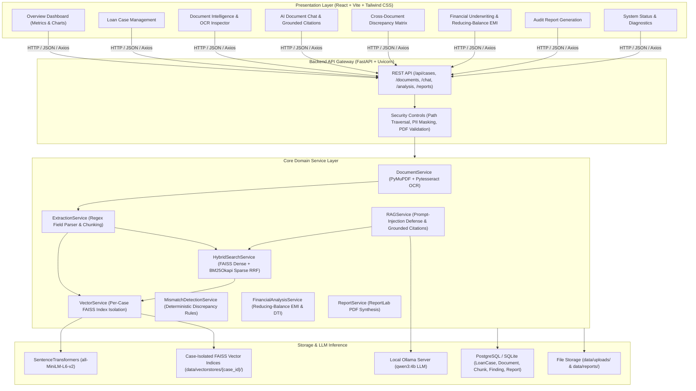

# Banking Loan Document Intelligence & Review Platform

[](https://fastapi.tiangolo.com)
[](https://react.dev)
[](https://tailwindcss.com)
[](https://github.com/facebookresearch/faiss)
[](https://ollama.com)
[](https://www.postgresql.org)
[-success?style=flat-square)](https://pytest.org)

An enterprise-grade, full-stack Banking Loan Document Intelligence, Cross-Document Discrepancy Detection, Financial Underwriting, and Hybrid Retrieval-Augmented Generation (RAG) platform.

This platform replaces monolithic Streamlit prototypes with an asynchronous FastAPI backend and a modern React + Vite + Tailwind CSS financial dashboard.

---

## 1. Architectural Diagram



---

## 2. Key Features

- **Streamlit to React Upgrade**: Clean separation between a fast, modular React single-page financial dashboard and an asynchronous REST API backend.
- **Strict Case Multi-Tenancy**: Vector indices, BM25 indices, and documents are strictly isolated per loan case (`data/vectorstores/{case_id}/`). Queries in one case can **never** retrieve chunks from another applicant.
- **Hybrid Search (Dense + Sparse)**: Combines dense semantic vector retrieval (FAISS `IndexFlatIP` with normalized embeddings) and lexical keyword matching (`BM25Okapi`) via Reciprocal Rank Fusion (RRF).
- **Anti-Hallucination Grounded Citations**: Structured citations (Document Name, Page Number, Match Score, Excerpt) are derived directly from retrieved chunks, preventing LLM fabrication.
- **Cross-Document Discrepancy Engine**: Deterministically identifies variances across loan applications, pay slips, bank statements, and ID cards:
  - Stated monthly income vs gross/net pay slip vs bank statement credits.
  - Employer name matching and fuzzy variations.
  - Applicant name checks across identity proofs.
  - Masked PAN and bank account identifier reconciliation.
- **Financial Underwriting & Reducing-Balance EMI**:
  - Implements the exact standard reducing-balance monthly loan amortization formula:
    $$\text{EMI} = \frac{P \times r \times (1 + r)^n}{(1 + r)^n - 1}$$
    where $P$ is principal, $r$ is the monthly interest rate, and $n$ is total months.
  - Separate zero-interest loan handler ($\text{EMI} = P / n$).
  - Computes Debt-To-Income (DTI), Total DTI including proposed EMI, EMI-to-Income ratio, and Net Disposable Income buffer.
  - Explainable underwriting risk tags (`LOW`, `MODERATE`, `HIGH`) and cash-flow anomaly warnings.
- **Audit-Ready PDF Report Generation**: Automatically compiles signed loan review summary reports using ReportLab, including document inventories, financial cash-flow tables, discrepancy matrices, and underwriter sign-off blocks.
- **Security & Privacy Guardrails**:
  - PDF-only upload enforcement and path-traversal prevention.
  - PII masking for account identifiers.
  - Prompt-injection defense: document context is treated strictly as untrusted raw facts inside isolated `<document_context>` wrappers.

---

## 3. Technology Stack

| Layer | Technologies |
| :--- | :--- |
| **Frontend** | React 18, JavaScript / JSX, Vite 5, Tailwind CSS, Lucide React, Recharts, Axios, React Router 6 |
| **Backend** | Python 3.11+, FastAPI, Uvicorn, Pydantic v2, SQLAlchemy 2.0, Alembic |
| **Database** | PostgreSQL 16 (production/Docker) & SQLite fallback (zero-config local dev) |
| **RAG & Search** | PyMuPDF (fitz), Pytesseract OCR, Sentence-Transformers (`all-MiniLM-L6-v2`), FAISS CPU, Rank-BM25 |
| **LLM Inference** | Ollama local instance running `qwen3:4b` |
| **Document Generation** | ReportLab 4.x / 5.x |
| **Testing** | Pytest, FastAPI TestClient, in-memory isolation fixtures |
| **Infrastructure** | Docker, Docker Compose, Multi-stage builds |

---

## 4. Prerequisites

- **OS**: Windows 11 / 10, Linux, or macOS.
- **Python**: Version 3.10+ (tested with Python 3.11 - 3.14).
- **Node.js**: Version 18+ (tested with Node v24).
- **Ollama**: Installed and running locally ([Download Ollama](https://ollama.com)).
- **Docker**: (Optional, for containerized deployment) Docker Desktop with Compose v2.

---

## 5. Local Setup on Windows 11 (Native Development)

### Step 1: Clone Repository
```powershell
git clone https://github.com/pkrishnakumar282/loan_review_assistant.git
cd loan_review_assistant
```

### Step 2: Configure Environment
Copy `.env.example` to `.env`:
```powershell
Copy-Item .env.example .env
```
Default `.env` settings are pre-tuned for local development:
```ini
PROJECT_NAME="Banking Loan Document Review Assistant"
VERSION="2.0.0"
DATABASE_URL=sqlite:///./data/app.db
OLLAMA_URL=http://localhost:11434/api/generate
OLLAMA_TAGS_URL=http://localhost:11434/api/tags
OLLAMA_MODEL=qwen3:4b
EMBEDDING_MODEL=sentence-transformers/all-MiniLM-L6-v2
```

### Step 3: Setup Python Virtual Environment & Backend
```powershell
# Create virtual environment
python -m venv .venv
.\.venv\Scripts\Activate.ps1

# Install backend dependencies
pip install -r backend/requirements.txt

# Run database migrations
cd backend
alembic upgrade head
cd ..
```

### Step 4: Ensure Ollama is Running with Qwen3
In PowerShell:
```powershell
# Check if model is pulled
ollama list

# If qwen3:4b is not installed:
ollama pull qwen3:4b
```

### Step 5: Start the Backend Server
```powershell
.\.venv\Scripts\uvicorn.exe backend.app.main:app --host 127.0.0.1 --port 8000 --reload
```
- Interactive OpenAPI Documentation: [http://localhost:8000/docs](http://localhost:8000/docs)
- Alternative ReDoc Documentation: [http://localhost:8000/redoc](http://localhost:8000/redoc)

### Step 6: Setup & Start the React Frontend
In a second PowerShell terminal:
```powershell
cd frontend
npm install
npm run dev
```
Open your browser at **[http://localhost:5173](http://localhost:5173)**.

---

## 6. Docker Deployment (Docker Compose)

The repository provides a complete `docker-compose.yml` orchestrating PostgreSQL, the FastAPI backend, the React frontend, and persistent volumes.

### Option A: Run Backend, Frontend, and PostgreSQL in Docker (Ollama on Windows Host)
This is the recommended setup for low disk/memory overhead:
1. Ensure Ollama is running natively on your Windows PC.
2. In `docker-compose.yml`, the backend is already configured with `extra_hosts: host.docker.internal:host-gateway`.
3. Start the containers:
   ```bash
   docker compose up --build -d
   ```
4. Access:
   - Frontend: [http://localhost:5173](http://localhost:5173)
   - Backend API Docs: [http://localhost:8000/docs](http://localhost:8000/docs)

### Option B: Fully Containerized (Ollama in Docker)
```bash
docker compose --profile full up --build -d
# Download Qwen3 inside the container:
docker exec -it loan_review_ollama ollama pull qwen3:4b
```

### Shutdown
```bash
docker compose down
```

---

## 7. Automated Testing

The automated test suite covers all financial calculations, OCR fallbacks, corrupted and empty PDF edge cases, multi-tenant vector isolation, and REST APIs.

Run tests with `pytest`:
```powershell
.\.venv\Scripts\pytest.exe -v
```

### Verified Test Suite Summary (20 / 20 Passed)
- `test_system_health_endpoints` — Health and readiness checks.
- `test_case_crud_lifecycle` — Create, retrieve, update, and delete loan cases.
- `test_document_upload_and_pdf_validation` — Validates upload limits, enforces `.pdf`, and rejects unauthorized file types.
- `test_case_level_retrieval_isolation` — **Verifies zero data leakage between distinct loan cases.**
- `test_grounded_citations_and_no_hallucinations` — Proves answers are grounded strictly on retrieved chunks.
- `test_matching_salary_no_discrepancy` — Confirms consistent salary documents pass without flags.
- `test_divergent_salary_discrepancy` — Detects and flags stated vs pay-slip variance.
- `test_applicant_name_mismatch` — Detects mismatching names across documents.
- `test_formatting_only_differences_not_high_severity` — Distinguishes formatting noise from genuine discrepancies.
- `test_pan_number_mismatch` — Flags identity discrepancies with PII masking.
- `test_standard_reducing_balance_emi` — Mathematical verification of reducing balance EMI.
- `test_zero_interest_loan_emi` — Validates zero-interest edge cases ($P/n$).
- `test_zero_principal_or_tenure` — Validates zero-division guards.
- `test_financial_ratios_and_risk_scoring` — Tests DTI, Total DTI, EMI-to-income, and risk bands.
- `test_high_risk_and_negative_disposable_income` — Detects negative disposable income buffers.
- `test_valid_pdf_extraction` — PyMuPDF text parsing.
- `test_empty_pdf_error` — Validates empty PDF error handling.
- `test_corrupt_pdf_error` — Validates corrupt file protection.
- `test_sliding_window_chunking` — Validates chunk overlap and page number preservation.
- `test_regex_structured_field_extraction` — Tests regex recognition of financial and identity fields.

---

## 8. User Interface Tour & Screenshots

### Page A: Overview Dashboard
Displays aggregate portfolio statistics, processed documents, awaiting review counts, active discrepancies, risk distribution pie charts, and quick-action links.
> *Placeholder: Overview Dashboard Screenshot*
> ``

### Page B: Loan Case Management
Create new loan cases with custom reference numbers, upload document packages, select document categories, update review status (`PENDING`, `IN_REVIEW`, `APPROVED`, `REJECTED`, `FLAGGED`), and add reviewer notes.
> *Placeholder: Case Management Screenshot*
> ``

### Page C: Document Intelligence
Inspect extracted document text page-by-page, view OCR status flags, inspect recognized fields (Income, PAN, Employer, Existing EMI, Tenure, Address), and re-process documents.
> *Placeholder: Document Intelligence Screenshot*
> ``

### Page D: AI Document Chat
Ask natural language questions regarding the applicant's documents. The chat interface renders verified source citations (Document Name, Page Number, and Match Score) and displays retrieval and generation timings.
> *Placeholder: AI Chat Screenshot*
> ``

### Page E: Cross-Document Discrepancy Detection
Matrix comparing extracted values across different documents in the same case. Underwriters can review flagged discrepancies, update the status (`FLAGGED`, `CONFIRMED`, `DISMISSED`, `RESOLVED`), and save notes.
> *Placeholder: Mismatch Detection Screenshot*
> ``

### Page F: Financial Underwriting & EMI Analysis
Provides cash flow statement tables, automated reducing-balance EMI calculations, DTI gauges, net disposable income buffers, and policy violation alerts. Allows underwriters to test sensitivity scenarios with custom terms and rates.
> *Placeholder: Financial Analysis Screenshot*
> ``

### Page G: Audit Report Generation
One-click generation of comprehensive loan underwriting PDF review packages formatted with ReportLab. Includes full document inventory, financial ledgers, discrepancy summaries, and formal sign-off blocks.
> *Placeholder: Report Generator Screenshot*
> ``

### Page H: System Diagnostics & Settings
Live diagnostics checking database status, active vector indexes, Ollama engine connectivity, target model readiness, and security controls.
> *Placeholder: System Status Screenshot*
> ``

---

## 9. Security & Privacy Controls

1. **Strict Multi-Tenant Isolation**: FAISS indices and document chunks are partitioned by `case_id`. Cross-case vector retrieval is structurally prevented.
2. **Safe Filenames & Path Traversal Prevention**: Filenames are sanitized with regex, prefixed with unique UUIDs, and paths are validated via `Path.relative_to(BASE_DIR)`.
3. **Sensitive Identifier Masking**: Sensitive account numbers and PAN IDs are masked (`XXXXXXXX1234`) in UI presentation and reports.
4. **Prompt-Injection Defense**: User and document content is bounded within `<document_context>` XML wrappers with strict instructions forbidding prompt overriding.
5. **Deterministic Calculations**: No financial calculations (EMI, DTI, disposable cash) are delegated to the LLM; all calculations are executed deterministically in validated Python algorithms.

---

## 10. License

This project is licensed under the MIT License. Created for banking loan review automation and document intelligence research.
